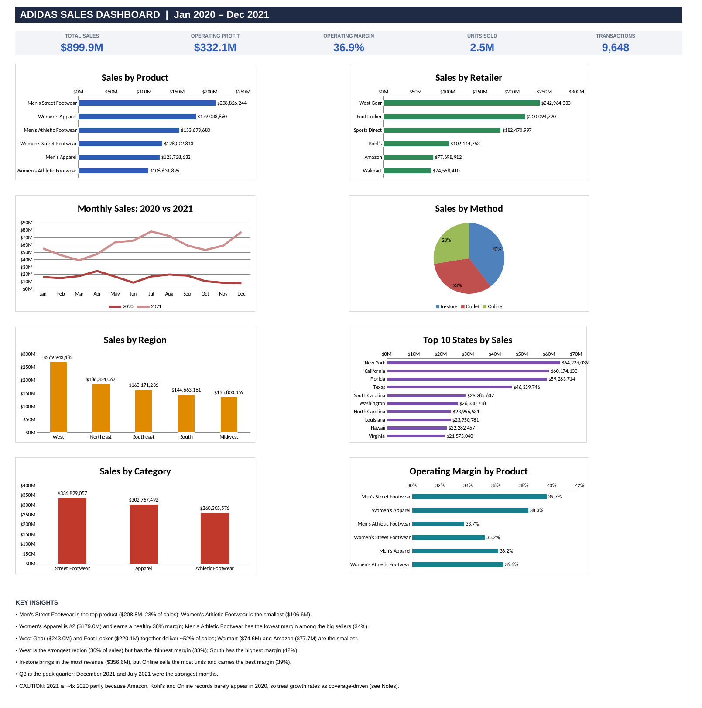
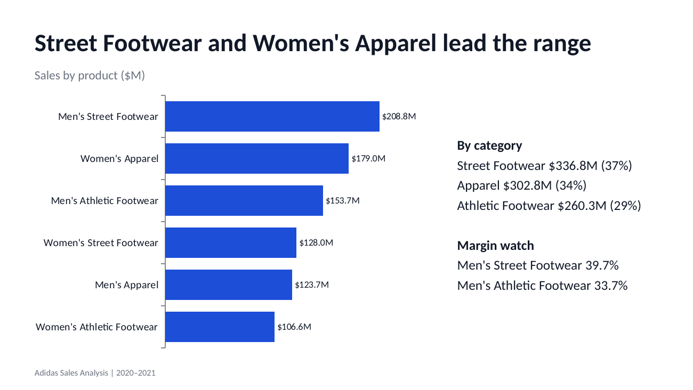
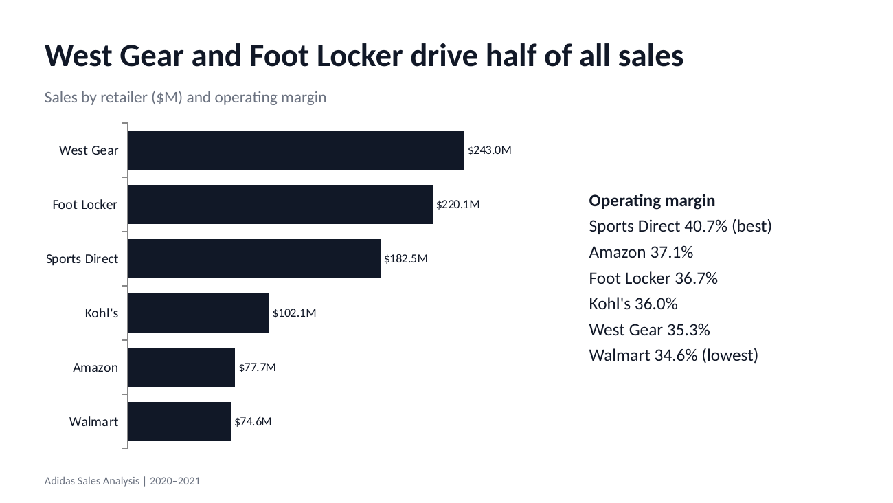
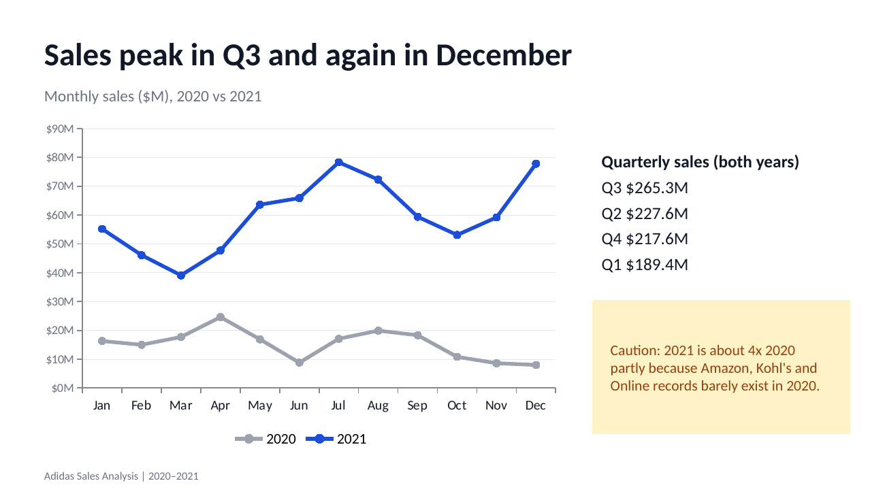
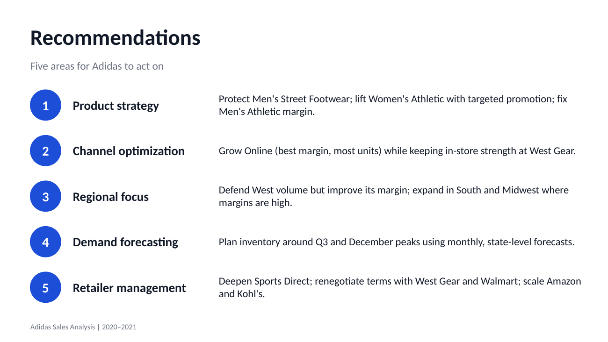
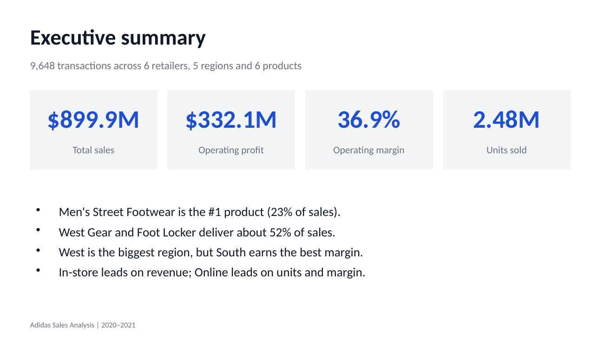

# Adidas Sales Data Analysis

**BeTechified Data Analytics Beginners Capstone Project**

An end-to-end analysis of Adidas sales across six retail partners, five US regions and three sales methods (January 2020 to December 2021). The goal is to find out which products, retailers, regions and channels drive revenue and profit, and to recommend where Adidas should focus next.



## Deliverables

| Deliverable | File |
|---|---|
| Excel dashboard | [Adidas_Sales_Dashboard.xlsx](Adidas_Sales_Dashboard.xlsx) |
| Presentation slides | [Adidas_Sales_Presentation.pptx](Adidas_Sales_Presentation.pptx) |
| Recommendations report (Word) | [Adidas_Recommendations.docx](Adidas_Recommendations.docx) |

## Project overview

Adidas sells through retailers such as Foot Locker, Walmart and Sports Direct, in-store, through outlets and online. The sales data was being collected but not fully used for decisions. This project turns it into insights on:

- Which products and retailers earn the most revenue and profit
- How performance differs by region, state and sales method
- How sales change by month and quarter
- Which areas underperform and need action

## Dataset

| Item | Detail |
|---|---|
| File | [`data.xlsx`](data.xlsx) (sheet: *Data Sales Adidas*) |
| Records | 9,648 transactions |
| Period | 1 Jan 2020 to 31 Dec 2021 |
| Retailers | West Gear, Foot Locker, Sports Direct, Kohl's, Amazon, Walmart |
| Regions | West, Northeast, Southeast, South, Midwest (50 states) |
| Products | Men's and Women's Street Footwear, Athletic Footwear and Apparel |
| Sales methods | In-store, Outlet, Online |
| Measures | Price per Unit, Units Sold, Total Sales, Operating Profit, Operating Margin |

## Method

1. **Cleaning:** removed blank header rows and columns. No missing values or duplicate rows were found.
2. **Feature engineering:** added Category (Apparel, Street Footwear, Athletic Footwear), Year, Quarter and Month.
3. **Analysis:** summarised sales, profit, units and margin by product, category, retailer, region, state, sales method and time period, using formulas in Excel.
4. **Reporting:** built an Excel dashboard, a slide deck and a recommendations report.

Operating margin is recalculated at each level (profit divided by sales), not averaged from row margins.

## Key findings

- **Totals:** $899.9M in sales and $332.1M in operating profit, a 36.9% margin on 2.48M units.
- **Products:** Men's Street Footwear is the top product ($208.8M, 23% of sales). Women's Apparel is second ($179.0M). Women's Athletic Footwear is the smallest ($106.6M).
- **Retailers:** West Gear ($243.0M) and Foot Locker ($220.1M) deliver about 52% of sales. Sports Direct has the best margin (40.7%). Walmart has the lowest (34.6%).
- **Regions:** West is the largest (30% of sales) but has the thinnest margin (33.2%). South has the best margin (42.3%).
- **Sales method:** In-store earns the most revenue ($356.6M). Online sells the most units and has the best margin (39.0%).
- **Seasonality:** Q3 is the strongest quarter, with December 2021 and July 2021 the peak months.

## Recommendations (summary)

| Area | Recommendation |
|---|---|
| Product strategy | Protect Men's Street Footwear and Women's Apparel; fix the margin on Men's Athletic Footwear; test the weakest line before investing |
| Channel optimization | Grow Online; keep in-store strong at West Gear; use Outlet for clearance |
| Regional focus | Improve margin in West; expand in South and Midwest |
| Demand forecasting | Plan stock around Q3 and December; forecast by product, region and month; add sales targets to the data |
| Retailer and partner management | Deepen Sports Direct; review terms with West Gear and Walmart; scale Amazon and Kohl's |

The full detail is in the Word report.

## Screenshots

### Dashboard overview


### Sales by product


### Sales by retailer


### Monthly sales trend, 2020 vs 2021


### Recommendations


### Executive summary


## Limitations

- The data has **no sales targets or forecasts**, so performance against targets could not be measured. 2020 was used as a benchmark instead.
- **2021 is about 4x 2020, partly because of data coverage:** Amazon has no 2020 records, Kohl's has only 8, and Online has far fewer records in 2020. Growth rates should be read with this in mind.
- The data covers footwear and apparel only, with no accessories category.
- Retailer ID is not unique to a retailer, so retailers were analysed by name.

## Repository contents

```
Adidas Sales Performance Analysis/
├── README.md
├── data.xlsx
├── Adidas_Sales_Dashboard.xlsx
├── Adidas_Sales_Presentation.pptx
├── Adidas_Recommendations.docx
├── notes.txt
└── screenshots/
    ├── 1_Dashboard_Overview.png
    ├── 2_Products.png
    ├── 3_Retailers.png
    ├── 4_Monthly_Trend.png
    ├── 5_Recommendations.png
    └── 6_Executive_Summary.png
```

## Tools

Microsoft Excel (formulas, pivot-style summaries, charts), PowerPoint, Word.

## Team

BeTechified Data Analytics Capstone Group

- [](https://github.com/Wisdom-Ukpong)

## Acknowledgements

Thanks to BeTechified and our instructors for the guidance and the capstone brief.
